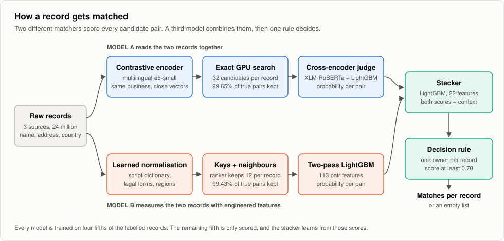
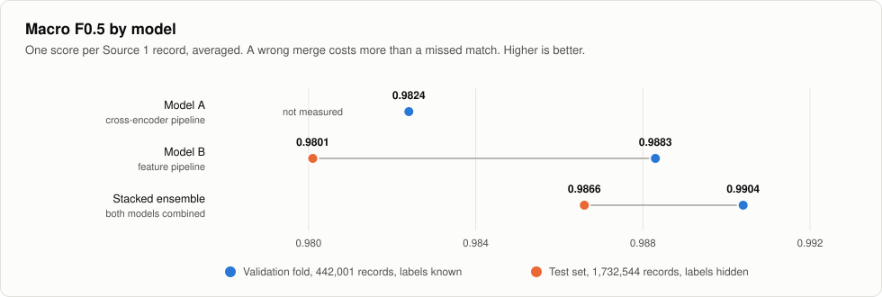
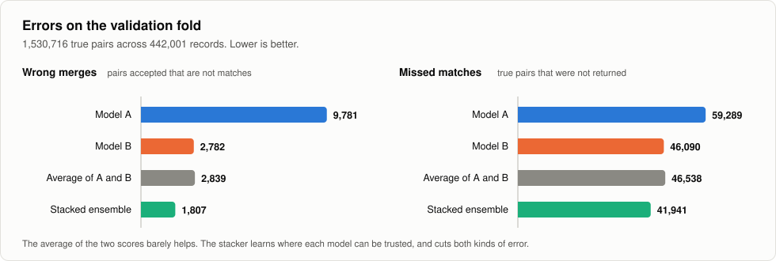
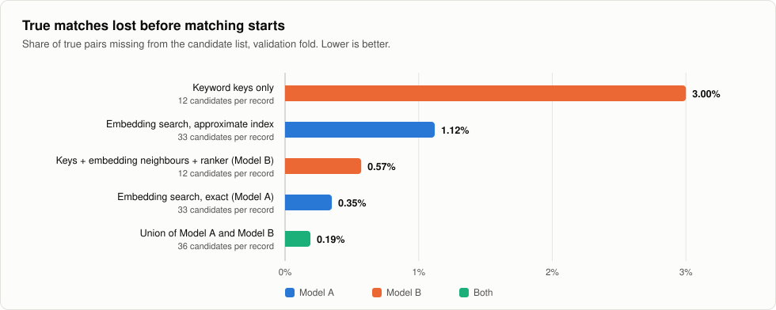

# Linking business records across three noisy, multilingual sources

The same business shows up in different databases under different names. One source writes
`Dynamic Power Private Limited`, another writes `डायनामिक पावर प्राइवेट लिमिटेड`, a third writes `DP`
and leaves the address out. No shared ID connects them.

This repository matches 1.7 million reference businesses against 10 million records from two other
sources, and reaches a **macro F0.5 of 0.9866** on a test set with hidden labels.

<picture>
  <source media="(prefers-color-scheme: dark)" srcset="docs/figures/pipeline-dark.svg">
  
</picture>

## The problem

Three sources hold records with four fields: an ID, a business name, an address and a country.

| Source | Role | Training records | Test records |
| --- | --- | --- | --- |
| Source 1 | reference list, one record per business | 2,206,821 | 1,732,544 |
| Source 2 | to be matched | 5,034,616 | 4,887,273 |
| Source 3 | to be matched | 5,285,603 | 5,082,316 |

For every Source 1 record, the task is to list all records in Source 2 and Source 3 that describe
the same real-world business. The list can be empty, and it can hold ten records.

What makes it hard:

| Difficulty | Share of true matches |
| --- | --- |
| Name is not identical | 79% |
| Name differs only in legal form, such as `Pvt Ltd` and `Private Limited` | 21% |
| Name is reordered or has a typo | 30% |
| Name is in one of nine Indian scripts | 7%, and 18% in India |
| Name is a website or an unrelated trade name | 8% |
| The matching record has no address | 4% |

Three more facts shape the design:

- **Look-alikes are everywhere.** One name can belong to 250 different businesses. An estimated 40% of the
  test records in Source 2 and Source 3 belong to no listed business at all.
- **A third country appears only in the test set.** Training covers the US and India. The test set
  adds France, which is 15% of it.
- **A wrong merge costs more than a miss.** The score is macro F0.5: one F0.5 per Source 1 record,
  averaged. A record with no true match scores 1 for an empty list and 0 for anything else.

An example of one business across the sources:

| Source | Name | Address |
| --- | --- | --- |
| 1 | Raj Investments LLP | 6(29), C.I.T. Colony, 2Nd Main Road Mylapore, Chennai, Tamil Nadu |
| 2 | ராஜ் இன்வெஸ்ட்மெண்ட்ஸ் எல்எல்பி | 6(29), C.I.T. COLONY, 2ND MAIN ROAD MYLAPORE, CHENNAI, Tamil Nadu |
| 3 | Raj Investments எல்எல்பி | 6(29), C.i.t. Colony, 2Nd Main Road Mylapore, Chennai, TN |

And a look-alike that is not a match:

| Source | Name | Address |
| --- | --- | --- |
| 1 | Brown National Safety LLC | 136 Dovenshire Drive, Fairfield Glade, TN |
| 3 | Brown National Security LLC | 143 Dovenshire Drive, Fairfield Glade, Tennessee |

## Results

<picture>
  <source media="(prefers-color-scheme: dark)" srcset="docs/figures/scores-dark.svg">
  
</picture>

| Model | Validation fold | Test set |
| --- | --- | --- |
| Model A, cross-encoder pipeline | 0.9824 | not measured |
| Model B, feature pipeline | 0.9883 | 0.9801 |
| **Stacked ensemble** | **0.9904** | **0.9866** |

The validation fold is a fifth of the labelled records, 442,001 businesses, that no model was
trained on. The test set has 1,732,544 businesses and its labels are hidden.

<picture>
  <source media="(prefers-color-scheme: dark)" srcset="docs/figures/errors-dark.svg">
  
</picture>

## How it works

### 1. Finding candidates

Comparing every reference record with every other record would mean 17 trillion pairs. Each model
first builds a short list of candidates per record.

<picture>
  <source media="(prefers-color-scheme: dark)" srcset="docs/figures/blocking-dark.svg">
  
</picture>

- **Model A** fine-tunes a multilingual sentence encoder with a supervised contrastive loss, so
  records of the same business land close together, across scripts. It then takes the nearest
  records by exact search on the GPU.
- **Model B** builds compound keys from rare name and address words, adds the encoder's nearest
  neighbours, and lets a learned ranker keep the best 12.

### 2. Judging each pair

- **Model A** uses a cross-encoder. It reads both records in one sequence, so it can notice that two
  different names share a house number, or that two identical names sit on different streets.
- **Model B** uses 113 engineered features and a two-pass gradient-boosted model. The second pass
  compares each candidate with the record's other confident matches.

### 3. Combining and deciding

A small gradient-boosted model takes both probabilities and learns where each model can be trusted.
It is trained on the validation fold, where both models' scores are out of sample. Then one rule
decides:

1. A record from Source 2 or 3 goes only to the reference business that scores it highest.
2. A candidate is kept if its score is at least 0.70 and within 0.2 of that business's best score.
3. If nothing is kept, the list stays empty.

## What we learned

- **Approximate search loses matches in crowds.** A standard approximate index missed 1.12% of the
  true pairs. Two thirds of those were inside the exact top 25. Businesses that share a name form
  dense groups of near-identical vectors, and the index gets lost there. Exact search found more,
  and ran in 14 minutes against 80.
- **Two different models beat one better model.** The models agree on 98.8% of the pairs. Averaging
  their scores barely helps. A stacker that learns when to trust which one cuts wrong merges by
  35% against the stronger model.
- **Validation has to look like the test.** The test set has about twice the look-alikes per
  business. Model B dropped from 0.9883 to 0.9801 between validation and test. The ensemble dropped
  less than half as much.
- **Features must not depend on the pool size.** The validation fold has 442,001 businesses
  competing for records and the test set has 1.7 million. The stacker uses no feature that counts
  competitors.
- **Some errors cannot be fixed from the data.** 77% of the remaining misses are records with no
  address whose name is shared by several businesses. Nothing in the record says which branch it
  belongs to, and leaving it out is the better choice under this score.

The full write-up is in [docs/METHODOLOGY.md](docs/METHODOLOGY.md).

## Repository layout

| Path | Content |
| --- | --- |
| `src/run_all.py` | runs every stage in order |
| `src/model_a/` | Model A: encoder, exact search, cross-encoder, combiner |
| `src/*.py` | Model B: normalisation, blocking, ranker, features, matcher |
| `src/encoder_v1/`, `src/gpu/` | the embeddings Model B reads |
| `src/ensemble/` | stacker and decision rule |
| `src/check_outputs.py` | checks the two result files |
| `results/matching_results.tsv.gz` | the final matches for the 1,732,544 test businesses |
| `docs/METHODOLOGY.md` | design, experiments, error analysis |
| `docs/figures/` | the figures above and the script that draws them |

## Running it

The data is not part of this repository. Place it like this:

```
data/train/train_source1.tsv   train_source2.tsv   train_source3.tsv   train_ground_truth.tsv
data/test/test_source1.tsv     test_source2.tsv    test_source3.tsv
```

Source files are tab-separated with the columns `entity_id`, `business_name`, `business_address`
and `country`. The ground truth has `source1_entity_id` and `matched_entity_ids`, a comma-separated
list that may be empty.

```bash
uv venv --python 3.12 .venv
uv pip install --python .venv/bin/python -r requirements.txt

cd src
../.venv/bin/python -u encoder_v1/run_encoder_v1.py    # GPU: first encoder and training embeddings
# then the test embeddings and neighbour lists, see src/gpu/README.md
../.venv/bin/python -u run_all.py                      # Model B, Model A, stacker, decision, check
../.venv/bin/python run_all.py --list                  # the stages
```

Results are written to `output/matching_results.tsv` and `output/candidate_pairs.tsv`.

| Part | Hardware we used | Time |
| --- | --- | --- |
| Model B | Apple M4 Pro, 48 GB RAM | about 3 hours |
| Model A | 2 x RTX 4090, 125 GB RAM | about 5.5 hours |
| Stacker and decision | CPU, 125 GB RAM | about 45 minutes |

Models are retrained from the data with fixed seeds. GPU training is not bit-exact, so a rerun
reproduces the results up to training randomness. The final matches behind the numbers above are in
`results/matching_results.tsv.gz`. The candidate file is 833 MB and is not part of the repository.

## Models and licences

| Model | Parameters | Licence | Used for |
| --- | --- | --- | --- |
| `intfloat/multilingual-e5-small` | 118M | MIT | record embeddings |
| `FacebookAI/xlm-roberta-base` | 278M | MIT | cross-encoder |
| LightGBM | | MIT | matcher, combiner, stacker |
| scikit-learn HistGradientBoosting | | BSD-3 | candidate ranker |

No external data, lookups or geocoding are used. Everything is learned from the training records.

## Team

Abhimanyu Vashishtha, Puneet Mishra, Kashif Khan, Shivam Tiwari.
